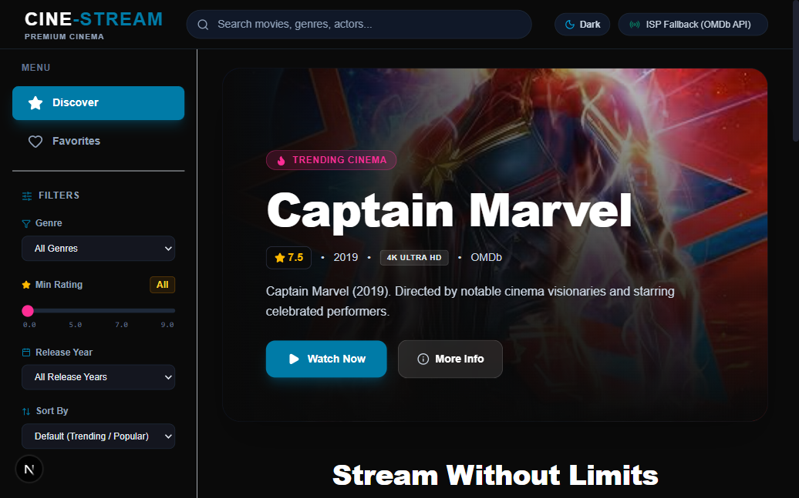
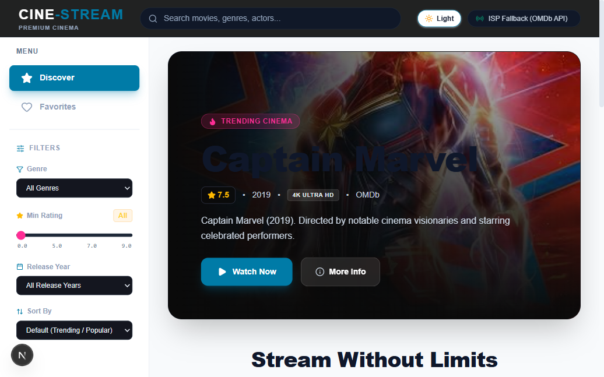
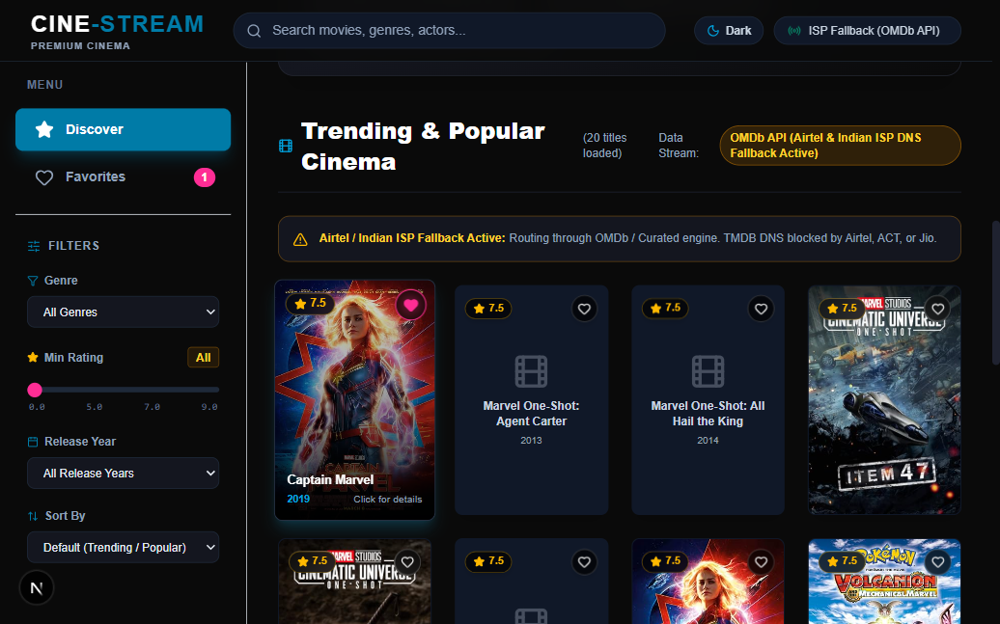

# Cine-Stream — Sprint 10: "The Data Storm"
> **Next.js 15 App Router • Redux Toolkit (RTK) • Redux-Persist • Tailwind CSS**

Cine-Stream is a premium cinematic VOD streaming and movie discovery platform engineered during the Prodesk IT Residency. Sprint 10 ("The Data Storm") modernizes the state layer by replacing React Context with a production-grade **Redux Toolkit** global store, multi-dimensional filtering, dynamic theming, and React 19 render optimizations.

---

## 🚀 Key Architectural Features

### 1. Global State Engine (Redux Toolkit & Redux-Persist)
- **Zero Context API / Zero Prop Drilling**: Centralized slices manage user favorites (`favoritesSlice`), catalog filtering (`filterSlice`), and theme mode (`themeSlice`).
- **SSR-Safe Persistence**: Implements an SSR-safe Web Storage fallback preventing server runtime crashes and Next.js hydration mismatch errors.
- **Client Boundary Architecture**: Isolated `<ReduxProvider>` and `<PersistGate>` inside a Client Component wrapper, ensuring `app/layout.js` retains full Server-Side Rendering (SSR) and streaming capabilities.

### 2. Multi-Dimensional Complex Filtering
- **Genre Taxonomy**: Interactive TMDB genre filtering matching numeric `genre_ids`, detailed `genres` arrays, and OMDb metadata.
- **Minimum Rating Slider**: Live threshold filtering (0.0 to 9.0) with dynamic star rating badges (`★ 7.5+`).
- **Release Year / Era Filtering**: Filter by exact years (`2024`, `2023`, etc.) or decade boundaries (`2010s`, `2000s`, `1990s`).
- **Real-Time Active Filter Bar**: Displays matching title counts and provides instant single-click resets.

### 3. Dynamic Theming Engine (Dark & Light Modes)
- **Persistent State**: Theme preference survives browser reloads via Redux-Persist.
- **DOM Class & Variable Sync**: Dynamically toggles `dark` / `light` classes and shifts CSS custom properties between Jet Black (`#0A0A0A`) and Soft Slate (`#F8FAFC`).
- **Theme Toggle Component**: Glassmorphic switcher with animated Sun and Moon icons in the top navigation bar.

### 4. High Frame-Rate Render Optimizations (60 FPS)
- **`useMemo` Filter Engine**: Single-pass array computation prevents expensive repaints during unrelated state updates.
- **`useCallback` Stability**: All dispatch mutations across filters, favorites, and theme toggle maintain referential stability.
- **`React.memo` Isolation**: Poster cards (`MovieCard`), grids (`MovieGrid`), and sidebars are isolated against re-renders.

### 5. Resilient Streaming Infrastructure
- **Dual TMDB + OMDb ISP Fallback Engine**: Automatic DNS failover for Indian ISPs (Airtel, Jio, ACT).
- **Google Gemini AI Mood Matcher**: Natural language mood-to-movie synthesis.

---

## 📸 Screenshots

| Dark Mode (Default) | Light Mode Alternative |
| :---: | :---: |
|  |  |

| Live Filter & Redux Favorites Active |
| :---: |
|  |

---

## 🛠️ Getting Started

### 1. Prerequisites
- Node.js 18+ (tested on Node v20/v24)
- npm or pnpm

### 2. Installation
```bash
git clone https://github.com/Aman-0033/cine-stream-nextjs.git
cd cine-stream-nextjs
npm install
```

### 3. Environment Variables
Copy `.env.example` to `.env.local` and configure your API keys (optional; curated offline fallback is active by default):
```bash
cp .env.example .env.local
```
```env
NEXT_PUBLIC_TMDB_API_KEY=your_tmdb_api_key
NEXT_PUBLIC_OMDB_KEY=your_omdb_api_key
GEMINI_API_KEY=your_gemini_api_key
```

### 4. Run Development Server
```bash
npm run dev
```
Open [http://localhost:3000](http://localhost:3000) in your browser.

### 5. Production Build
```bash
npm run build
npm start
```

---

## 📑 Documentation
For detailed architectural decisions, implementation logs, and phase-by-phase execution notes, refer to:
- [`PROMPTS.md`](./PROMPTS.md) — Engineering & Architectural Log
